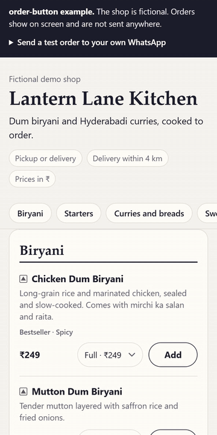

# order-button

A no-backend cart and "send order on WhatsApp" button for any static site.

Customers pick from the menu, add their name and address, and tap send. WhatsApp
opens with the whole order typed out, addressed to the shop's number. There is no
server, no database, no account and no commission: the order is a chat message the
customer sends to the shop themselves.

<p align="center"></p>

**Try it in 10 seconds:** download or clone this repo and open
[`examples/index.html`](examples/index.html) in a browser. It runs straight from disk.
The shop in it is made up, and it only shows the message unless you type in your own
number to send yourself a test order.

- **One file, no dependencies.** An ES module or a classic `<script>`, about 14 KB
  gzipped (minified). Optional CSS, about 3 KB gzipped.
- **Works with any static site:** plain HTML, Hugo, Jekyll, Eleventy, WordPress
  pages, Astro (a component is included). Give it a menu as JSON, or wire up the menu
  HTML you already have with `data-ob-*` attributes.
- **Real menus:** sizes (Half/Full, 500 g/1 kg), sold-out items, veg and non-veg
  marks, pickup or delivery, a minimum order and a delivery fee.
- **After sending:** a pay panel with the exact amount and the shop's UPI QR and
  UPI ID, a Pix key, or any payment link.
- **A free Claude Code skill**, [`/menu-from-photo`](#the-menu-from-photo-skill), turns a
  photo of a menu into the JSON.
- **Accessible:** native `<dialog>`, labelled steppers, 44 px tap targets, field errors
  linked to their fields, cart changes announced to screen readers.

## The message

This is what arrives on the shop's phone (from the example above):

```
New order #LLK-0811-4821
Lantern Lane Kitchen
----------------
2 x Chicken Dum Biryani (Half) = ₹298
1 x Double Ka Meetha = ₹89
----------------
Total: ₹387
Name: Ravi
Delivery: 12-3-45, Ameerpet
Note: less spicy
Payment: UPI to sampleshop@example
```

The order ID is a prefix (the shop's initials by default), the day and month in the
shop's time zone, and 4 random digits. It helps the shop match a payment to an order.

## Quick start (30 seconds)

1. Copy `dist/order-button.iife.min.js` and `dist/order-button.min.css` next to your page.
2. Paste this where the menu should go, with the shop's details:

```html
<link rel="stylesheet" href="order-button.min.css">

<div data-ob-menu></div>

<script type="application/json" data-order-button>
{
  "shop": { "name": "Sample Tea Stall", "whatsapp": "919800000000" },
  "menu": {
    "categories": [
      {
        "id": "tea",
        "name": "Tea and snacks",
        "items": [
          { "id": "masala-chai", "name": "Masala chai", "price": 20 },
          { "id": "bun-maska", "name": "Bun maska", "price": 30 }
        ]
      }
    ]
  }
}
</script>

<script src="order-button.iife.min.js"></script>
```

3. Open the page. The menu appears, a "View order" bar shows up once something is in
   the cart, and the order goes to the number in `whatsapp` (digits only, country code
   first, no `+`).

While testing, add `"ordering": { "previewOnly": true }`: the message is shown on screen
instead of opening WhatsApp.

Once this repo is public with a release tag, jsDelivr can serve the files too:
`https://cdn.jsdelivr.net/gh/counterkit/order-button@v1.0.0/dist/order-button.iife.min.js`
(and `.../dist/order-button.min.css`).

## The menu file

One JSON object. Only `shop.name`, `shop.whatsapp` and the menu are required.
[`examples/menu.json`](examples/menu.json) is a full example, and
[`order-button.schema.json`](order-button.schema.json) gives your editor autocomplete
(add `"$schema": "./order-button.schema.json"`). Keys starting with `_`, like `_note`,
are ignored anywhere.

| Field | Default | What it does |
|---|---|---|
| `shop.name` | | Shop name, the second line of the message |
| `shop.whatsapp` | | Number that receives orders: `919800000000` |
| `shop.currency` | `INR` | ISO code: `INR`, `BRL`, `AED`, `NGN`, `KES`, `USD`... |
| `shop.currencySymbol` | from `Intl` | Sign to show, e.g. `₹`, `R$` |
| `shop.locale` | `en-IN` | Number format: `en-IN` gives ₹1,23,456, `pt-BR` gives R$ 25,90 |
| `shop.timezone` | visitor's | For the date in the order ID, e.g. `Asia/Kolkata` |
| `ordering.modes` | both | `["pickup"]`, `["delivery"]` or `["pickup", "delivery"]` |
| `ordering.minOrder` | `0` | Minimum item total before the order can be sent |
| `ordering.deliveryFee` | `0` | Added to delivery orders and shown in the message |
| `ordering.deliveryNote` | | Shown under the address field, e.g. "Delivery within 3 km" |
| `ordering.orderPrefix` | initials | `LLK` in `LLK-0811-4821` |
| `ordering.previewOnly` | `false` | Show the message on screen and never open WhatsApp |
| `payment` | `{ "type": "none" }` | See [Payments](#payments) |
| `menu.categories[]` | | `{ "id", "name", "items": [...] }` |
| `items[].id` | | Lowercase letters, digits and dashes; unique in the menu |
| `items[].name`, `price` | | Price is a number without a currency sign |
| `items[].description` | | One line under the name |
| `items[].variants` | | Sizes: `[{ "id": "half", "name": "Half", "price": 149 }, ...]`. The item's `price` should equal the size that is picked first. |
| `items[].veg` | | `true` or `false` shows a veg or non-veg mark; leave out for none |
| `items[].available` | `true` | `false` shows "Sold out" |
| `items[].tags` | | Small text: `bestseller`, `spicy`, `new`, `jain`, `eggless`, `chef-special`, or your own words |
| `items[].image` | | Optional photo URL |
| `labels` | | Change any text, see [Labels](#labels-and-other-languages) |

Check a file before you use it. The checker explains each problem by field:

```
node .claude/skills/menu-from-photo/check-menu.mjs menu.json
```

```
menu.json: 2 errors. 4 categories, 15 items, 4 with sizes.
  error    shop.whatsapp: "09800012345" starts with 0. Start with the country code instead (India 91, Brazil 55, UAE 971).
  error    menu.categories[1].items[0].price ("Chicken 65"): must be a number, 0 or more, without a currency sign.
```

In the browser, `init()` logs the same messages to the console.

## Use the menu HTML you already have

Skip the JSON menu rendering and add attributes to your own markup. The JSON still
holds the prices (prices are never read from the page), so ids must match.

```html
<button data-ob-open>Order (<span data-ob-count>0</span>) <span data-ob-total></span></button>

<article data-ob-item="chocolate-truffle">
  <h3>Chocolate truffle cake</h3>
  <label><input type="radio" name="size" value="500g" data-ob-variant checked> 500 g</label>
  <label><input type="radio" name="size" value="1kg" data-ob-variant> 1 kg</label>
  <span data-ob-price>₹450</span>
  <button data-ob-add>Add</button>
  <span data-ob-stepper hidden>
    <button data-ob-dec aria-label="One less chocolate truffle cake">−</button>
    <span data-ob-qty>0</span>
    <button data-ob-inc aria-label="One more chocolate truffle cake">+</button>
  </span>
</article>

<button data-ob-add="plum-cake">Add a plum cake slice</button>
```

| Attribute | Where | What happens |
|---|---|---|
| `data-ob-item="id"` | an item's wrapper | Marks the item. Gets `data-ob-in-cart` while it is in the cart. |
| `data-ob-add` | button in an item | Adds one. Hidden while the stepper shows, if there is one. |
| `data-ob-add="id"` | any button | Adds one of that item. Add `data-ob-variant="half"` for a size. |
| `data-ob-inc`, `data-ob-dec` | buttons in an item | One more, one less |
| `data-ob-qty` | in an item | Shows the quantity |
| `data-ob-stepper` | in an item | Shown once the item is in the cart (with `data-ob-add`) |
| `data-ob-variant` | `<select>` or radios in an item | The chosen size |
| `data-ob-price` | in an item | Updated to the chosen size's price |
| `data-ob-open` | any element | Opens the order sheet |
| `data-ob-count`, `data-ob-total` | anywhere | Live item count and item total |
| `data-ob-menu` | an empty element | The menu is rendered here |

[`examples/existing-markup.html`](examples/existing-markup.html) is a full page built
this way, with its own cart button instead of the floating bar. On the JSON block,
`data-bar="false"` turns the bar off and `data-menu="#id"` picks where the menu goes.

## Astro

```astro
---
import OrderButton from '@counterkit/order-button/astro';
import menu from '../data/menu.json';
---
<OrderButton config={menu} />
```

The component renders the menu as plain HTML at build time, so it is in the page for
search engines and slow phones, and then starts the cart in the browser. Props:
`config`, `renderMenu` (default `true`), `bar` (default `true`), `heading` (default `2`)
and `class`. Use one per page.

To install it from GitHub: `npm install github:counterkit/order-button`. Or copy the
`astro/` and `dist/` folders into your project and import `astro/OrderButton.astro`
from there. [`examples/astro/index.astro`](examples/astro/index.astro) is a whole page.

## JavaScript API

```js
import { init } from './order-button.min.js'; // or window.OrderButton.init with the classic script

const ob = init(config, { menu: '#menu' });
ob.add('masala-chai');          // add one (a size: ob.add('chicken-dum-biryani', 'half'))
ob.open();                      // open the order sheet
ob.set({ whatsapp: '919800000000', previewOnly: false });
ob.destroy();                   // remove listeners, dialogs and the bar (the cart stays saved)
```

`init(config, options)`

| Option | Default | |
|---|---|---|
| `menu` | an empty `[data-ob-menu]` | Selector or element to render the menu into. `false` never renders. |
| `bar` | `true` | The floating "View order" bar |
| `labels` | | Text overrides, on top of `config.labels` |
| `previewOnly` | from config | Override preview mode |
| `onOrder(order)` | | Called after send |
| `storageKey` | `ob:<shop-name>` | localStorage key prefix |
| `root` | `document` | Only wire `data-ob-*` hooks inside this element |
| `heading` | `2` | Heading level for category titles |
| `quiet` | `false` | Don't log config problems |

The instance has `cart`, `config`, `open()`, `close()`, `add()`, `set()`, `sync()` (call it
after you add menu markup later), `destroy()` and `problems` (the config check result).

After send, `window` gets an `orderbutton:order` event. `event.detail` is
`{ id, text, url, total, mode, lines, at, preview }`, handy for analytics or a thank-you
note. `orderbutton:ready` fires when an instance starts.

The parts are exported too, so you can build your own UI:

| Export | |
|---|---|
| `createCart({ storageKey, catalog, minOrder, deliveryFee })` | Cart state with `add`, `setQty`, `lines`, `totals(mode)`, `subscribe`. Money is counted in paise or cents, so totals never drift. |
| `buildOrderMessage({ id, shopName, lines, totals, customer, payment, money, labels })` | The message text |
| `makeOrderId(prefix, { timeZone })` | `LLK-0811-4821` |
| `waUrl(number, text)`, `openWhatsApp(url)` | The `wa.me` link; same tab on phones, new tab on desktops |
| `menuHTML(config)`, `renderMenu(el, config)` | Menu markup as a string (works in Node) or into an element |
| `validateConfig(config)` | `{ errors, warnings }` in plain words |
| `mountCheckout(...)`, `renderPayment(...)` | The dialogs and the pay block |
| `createMoney({ locale, currency, symbol })` | Price formatter |
| `LABELS` | Every English text |

## Payments

order-button never takes, holds or checks money. After the order is sent, a pay panel
shows what the shop asks for:

```json
"payment": {
  "type": "upi",
  "upi": { "vpa": "shopname@example", "payeeName": "Shop name", "qrImage": "upi-qr.png" },
  "note": "Pay after the shop confirms your order on WhatsApp."
}
```

- `upi` (India): the exact amount, the shop's own UPI QR image, the UPI ID with a copy
  button, and a hint to put the order ID in the payment note. A "Pay with a UPI app"
  (`upi://pay`) button appears on phones only with `"intent": true`. NPCI disallowed
  peer-to-peer intent payments from 1 April 2024, so turn it on only for verified
  merchants whose payment provider supports it.
- `pix` (Brazil): `{ "type": "pix", "pix": { "key": "...", "qrImage": "..." } }`
- `link`: one button to any payment link: `{ "type": "link", "link": { "url": "https://...", "label": "Pay online" } }`
- `none`: "Pay the shop when you collect or receive your order."

## Styling

The CSS is optional. It uses plain `.ob-*` class selectors, so element rules on your
page (`footer`, `button`, `h2`) don't reach inside, and your own `.ob-*` rules win when
they come later. Set these on `:root` or `body`:

```css
:root {
  --ob-paper: #fff;        /* dialogs and buttons */
  --ob-ink: #1d1e2c;       /* text and outlines */
  --ob-muted: #5a5c6e;
  --ob-line: #dfe0e8;
  --ob-soft: #f3f3f7;      /* quiet backgrounds */
  --ob-accent: #1d1e2c;    /* the bar and the send button */
  --ob-on-accent: #fff;
  --ob-focus: #2a49d8;
  --ob-error: #b3261e;
  --ob-veg: #12813a;
  --ob-nonveg: #9a3412;
  --ob-radius: 14px;
  --ob-font-display: inherit; /* titles */
}
```

The defaults are declared with zero specificity, so your values always win. For a
dark page, set at least `--ob-paper`, `--ob-ink`, `--ob-muted`, `--ob-line` and
`--ob-soft`.

## Labels and other languages

Every text is English by default and can be changed with `labels`, including the
words in the message:

```json
"labels": {
  "checkout.send": "Enviar pedido pelo WhatsApp",
  "msg.newOrder": "Novo pedido",
  "msg.total": "Total"
}
```

Item and category names are used as you write them, in any script.

<details>
<summary>All label keys and their English text</summary>

<!-- labels:start -->
| Key | English text |
|---|---|
| `menu.add` | Add |
| `menu.addLabel` | Add {item} |
| `menu.soldOut` | Sold out |
| `menu.variant` | Size for {item} |
| `menu.veg` | Vegetarian |
| `menu.nonVeg` | Non-vegetarian |
| `menu.qty` | {item} in your order |
| `menu.increase` | One more {item} |
| `menu.decrease` | One less {item} |
| `tag.bestseller` | Bestseller |
| `tag.spicy` | Spicy |
| `tag.new` | New |
| `tag.jain` | Jain |
| `tag.eggless` | Eggless |
| `tag.chef-special` | Chef's special |
| `bar.view` | View order |
| `bar.items.one` | {count} item |
| `bar.items.other` | {count} items |
| `cart.added` | {item} added. {count} in your order. |
| `cart.updated` | {item}: {count} in your order. |
| `cart.title` | Your order |
| `cart.empty` | Your order is empty. Add something from the menu. |
| `cart.close` | Close |
| `cart.subtotal` | Item total |
| `cart.deliveryFee` | Delivery fee |
| `cart.total` | Total |
| `cart.minOrder` | The minimum order is {amount}. Add {short} more to order. |
| `cart.remove` | Remove {item} |
| `checkout.details` | Your details |
| `checkout.name` | Your name |
| `checkout.mode` | How do you want it? |
| `checkout.pickup` | Pickup |
| `checkout.delivery` | Delivery |
| `checkout.address` | Delivery address |
| `checkout.addressHint` | House number, street, landmark |
| `checkout.note` | Note for the shop (optional) |
| `checkout.notePlaceholder` | Less spicy, no onion, ring the bell... |
| `checkout.send` | Send order on WhatsApp |
| `checkout.sendHint` | WhatsApp opens with your order typed out. Press send there to place it. |
| `checkout.nameMissing` | Add your name so the shop knows who ordered. |
| `checkout.addressMissing` | Add the delivery address, or choose pickup. |
| `preview.title` | Order message |
| `preview.demo` | Preview mode: on a live site this opens WhatsApp with the message below. |
| `preview.copy` | Copy message |
| `preview.copied` | Copied |
| `preview.continue` | Continue to payment |
| `pay.title` | Pay now |
| `pay.intro` | Order {id}. If you have not sent the WhatsApp message yet, send it first, then pay here. |
| `pay.introPreview` | Order {id}. On a live site the message would now be open in WhatsApp, ready to send. |
| `pay.reopen` | Open WhatsApp again |
| `pay.newOrder` | Start a new order |
| `pay.resume` | Order {id}: pay {amount} |
| `pay.amount` | Amount to pay |
| `pay.upiScan` | Scan with any UPI app |
| `pay.upiId` | UPI ID |
| `pay.copyUpi` | Copy UPI ID |
| `pay.copied` | Copied |
| `pay.upiApp` | Pay with a UPI app |
| `pay.upiNoteHint` | Add {id} in the payment note so the shop can match it. |
| `pay.qrAlt` | UPI QR code for {name} |
| `pay.pixKey` | Pix key |
| `pay.copyPix` | Copy Pix key |
| `pay.pixQrAlt` | Pix QR code |
| `pay.link` | Pay online |
| `pay.none` | Pay the shop when you collect or receive your order. |
| `msg.newOrder` | New order |
| `msg.subtotal` | Item total |
| `msg.deliveryFee` | Delivery fee |
| `msg.total` | Total |
| `msg.name` | Name |
| `msg.delivery` | Delivery |
| `msg.pickup` | Pickup |
| `msg.note` | Note |
| `msg.payment` | Payment |
| `msg.upiTo` | UPI to {vpa} |
| `msg.pixTo` | Pix to {key} |
| `msg.payLink` | Online (payment link) |
<!-- labels:end -->

</details>

## The /menu-from-photo skill

[`.claude/skills/menu-from-photo/`](.claude/skills/menu-from-photo/SKILL.md) is a
Claude Code skill. Give it a
photo of a menu and it writes the `menu.json`:

```
/menu-from-photo examples/menu-photo.jpg "Lantern Lane Kitchen" 919800000000
```

It reads every photo, keeps names and prices as printed, turns price columns
(Half/Full, 500 g/1 kg) into sizes, only adds veg marks the menu shows, never guesses
a price it can't read, flags unclear readings with `_note`, and runs the checker
until the file is clean. You still check the prices with the shop before going live.

Open Claude Code in this repo to use it, or copy the `menu-from-photo` folder into
your own project's `.claude/skills/`. It needs only Node to run the checker.
[`examples/menu-photo.jpg`](examples/menu-photo.jpg) is a printed version of the example
menu to try it on.

## FAQ

**Does the shop need the WhatsApp Business API, or an account anywhere?**
No. It uses `https://wa.me/<number>?text=...` links, which work with the regular
WhatsApp and WhatsApp Business apps. The customer needs WhatsApp on their phone, or
WhatsApp Web or the desktop app on a computer.

**Is the order placed when the customer taps "Send order"?**
Not yet. WhatsApp opens with the message typed out, and the customer presses send there.
The sheet and the pay panel both say so. The shop then confirms in the chat, as it
would for any chat order.

**Can a customer change prices?**
Totals are calculated from your JSON, never from the page. But the message is plain
text, and the customer can edit it before sending, so the shop should check orders
against its menu.

**Where is customer data stored?**
In the customer's own browser. The cart (forgotten after 12 hours), and their name,
address and pickup/delivery choice for next time, are kept in `localStorage`.
order-button makes no network requests of its own (apart from loading any images
you list); the order leaves the phone only when the customer sends the WhatsApp message.

**Does it work on desktop?**
Yes. The `wa.me` link opens in a new tab, which hands over to WhatsApp Web or the
desktop app. On phones it opens in the same tab, which opens the app.

**Which browsers?**
Current Chrome, Edge, Firefox and Safari. It needs `<dialog>`, which all of them have
had since early 2022 (Safari 15.4).

**React, Vue, Svelte?**
Use the ES module: call `init()` when your component mounts and `destroy()` when it
unmounts. Or use `createCart()` and `buildOrderMessage()` with your own UI.

**Several shops or languages on one page?**
One `init()` per page. For other languages, use `labels`.

**Is it free for client work?**
Yes. It is MIT licensed: use it on as many sites as you like, paid or not. Keep the
licence notice in the file.

**Is this made by WhatsApp or Meta?**
No, and it is not affiliated with them. "WhatsApp" is used only to say where orders
arrive. There is no WhatsApp logo in this project.

## Development

```
npm install      # esbuild (minified builds) and playwright-core (browser tests); the shipped files need neither
npm test         # unit and build checks, no browser needed
npm run build    # dist/ and the skill's checker, from src/
npm run smoke    # opens both examples from disk in headless Edge or Chrome and places orders
npm run gif      # re-records docs/demo.gif (also needs ffmpeg)
```

The source is `src/order-button.js` and `src/order-button.css`. The files in `dist/`
are built from them and committed, so you can use the repo without building anything.
Issues and pull requests are welcome.

## Want the full kit?

order-button is the cart from **Counterkit by Halvex Labs**
([counterkit.halvexlabs.com](https://counterkit.halvexlabs.com)), a paid kit for freelancers and small agencies who build ordering sites for local
shops. The kit adds an Astro starter with two designed themes (restaurant and
kirana), English, Hindi and Telugu language packs, Claude Code skills for setting up,
deploying and handing over a client's site, and a business pack (pricing sheet,
proposal, outreach scripts, handover checklist). It is a one-time purchase.

You don't need it to use order-button. This repo stays MIT and works on its own.
Counterkit is made by [Halvex Labs](https://halvexlabs.com), a small web studio in
Hyderabad, India, that builds these sites for local shops.

## License

[MIT](LICENSE). Copyright (c) 2026 Halvex Labs.

WhatsApp is a trademark of its owner. This project is independent and is not
endorsed by or affiliated with WhatsApp or Meta.
